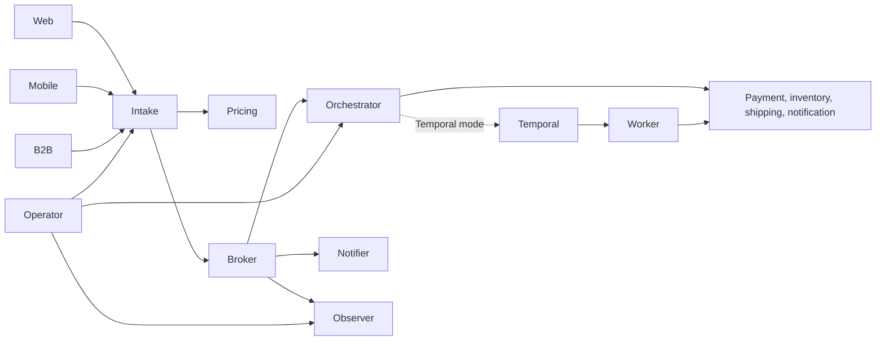
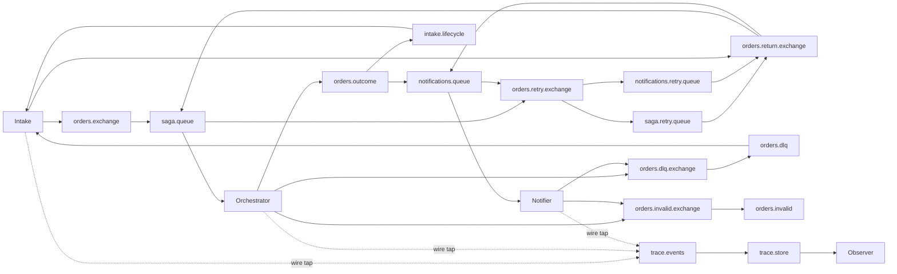

# Checkout integration
## System context
Web, mobile and B2B callers submit orders; an operator inspects failures and authorizes compensation. Provider mocks represent independent external systems. Acceptance is asynchronous, not proof of fulfilment.

## Integration architecture
The kit owns declarations. Confirm publishing precedes acceptance and acknowledgements. Rejected messages cross the TTL retry queue and return through their origin routing key. The extra intake.lifecycle queue follows outcomes independently of notification delivery.

Each service owns its named /data volume; no shared database is used. Hand-rolled mode persists intent and completed steps, but deliberately stops interrupted work for operator review. Temporal mode gives durable scheduling to the engine and executes provider I/O in activities. Neither mode promises exactly-once HTTP delivery; payment/inventory effects depend on provider idempotency keys.
